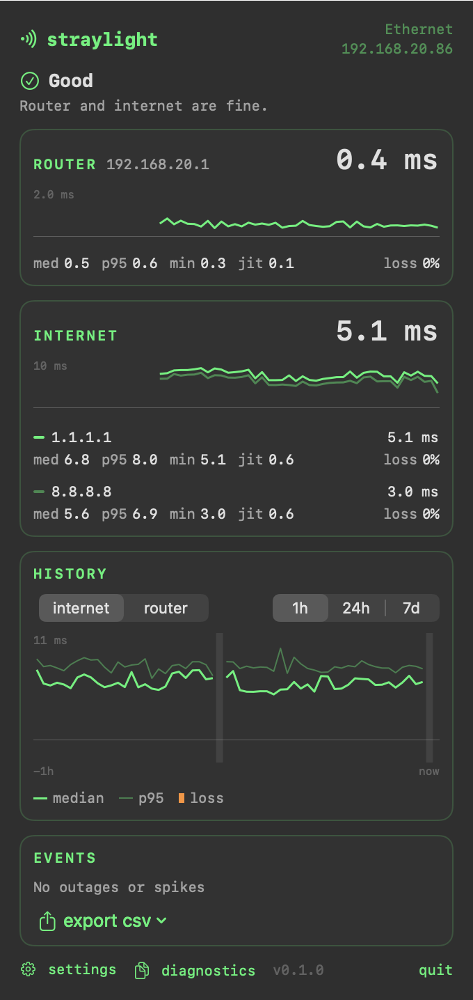

# straylight

A small menu bar app for Apple Silicon Macs that shows how good your connection is: **latency**, **jitter**, and **packet loss**, to your router and to the internet, side by side.

> Is it the Wi‑Fi, or the internet? straylight answers that at a glance.

<p align="center"></p>

straylight is a sibling to [flatline](https://github.com/banastas/flatline). flatline shows how much traffic is moving; straylight shows its quality. It follows the same rules: one narrow job, Apple Silicon and macOS 27 only, no root helper, and close to zero cost when idle.

**Status:** 0.1.0 is out; 1.0 follows once the remaining hands-on checks are done. See the [PRD](PRD.md).

## Features

- **Router and internet measured together**, with a plain verdict: Good, Internet problem, Internet down, Local network problem, or Offline
- **Two internet hosts from different providers**, so one provider's bad day doesn't look like your ISP's
- **Latency** (now, median, p95), **jitter**, and **loss** per target, with a 60-second trace. A lost ping drops the trace flat.
- **History**: per-minute stats for 7 days, hourly stats and a log of outages and spikes for 30 days (up to 90), with **CSV export** to send to your ISP
- **Wi‑Fi context**: signal strength, noise and transmit rate, so you can see when loss follows a weak signal
- Optional custom targets, such as a VPN endpoint or a game server
- Optional notifications for outages
- Fixed-width, monochrome menu bar; terminal-style popover with a phosphor accent
- Launch at login, automatic updates via [Sparkle](https://sparkle-project.org)
- No telemetry, no root helper, no kernel extensions

## Network traffic

straylight sends small ping packets (56 bytes) to the targets you choose: your router, `1.1.1.1` and `8.8.8.8` by default, plus `1.1.1.1` over IPv6 on networks that have it. That's one per target per second on power and one every 5 seconds on battery, briefly once a second after a network change or a lost ping. It stops while the screen is locked unless you turn on overnight monitoring. If a network blocks ping, it times a normal HTTPS connection instead. History stays on your Mac unless you export it.

## Requirements

- macOS 27 or later
- Apple Silicon (M1 or newer)

## Install

Download the latest version from **[straylight.banast.as](https://straylight.banast.as)**, open the DMG and drag straylight to Applications. It's signed and notarized, and updates itself.

## Building from source

Requires Xcode 27+ and [XcodeGen](https://github.com/yonaskolb/XcodeGen).

```bash
brew install xcodegen
xcodegen generate
open Straylight.xcodeproj
```

Unit tests run without Xcode:

```bash
swift test --package-path Packages/StraylightKit
```

`straylight-probe` is a development tool for checking the probes against `ping`; it isn't part of the app:

```bash
swift run --package-path Packages/StraylightKit -c release straylight-probe -c 60 1.1.1.1
```

`--monitor 120` runs the whole measuring pipeline for two minutes and prints the verdict and each target's stats after every round. Add `--history file.sqlite` to record history there, and `--export file.sqlite 30` prints the CSV for the last 30 minutes. `--tune file.sqlite 7` shows how often each "Bad" threshold would have fired over the last 7 days, for tuning them. Its source lists the other options.

The app reads a few environment variables for checking its drawing without clicking: `STRAYLIGHT_SNAPSHOT=bar.png` writes each menu bar image, `STRAYLIGHT_POPOVER_SNAPSHOT=popover.png` writes the popover after 15 seconds (`STRAYLIGHT_POPOVER_PAGE=settings`, `first-run`, `paused` or `wifi` picks what it shows), `STRAYLIGHT_HISTORY=test.sqlite` uses another history database, `STRAYLIGHT_HOSTS=1.1.1.1,192.0.2.1` sets the internet hosts, `STRAYLIGHT_ON_BATTERY=1` acts as if on battery, and `STRAYLIGHT_LOCK_TEST=10,40` acts as if the screen locked at 10 s and unlocked at 40 s. The comments in `StatusItemController.swift`, `AppModel.swift` and `SystemState.swift` list the rest.

Debug builds are ad-hoc signed and run on any Mac. Release builds are signed with the maintainer's Developer ID: `scripts/release.sh` tests, archives, signs, notarizes and staples the app and a DMG in `dist/` (`--skip-notarize` for a dry run), `scripts/bump-version.sh 0.2.0` sets the next version, and `scripts/deploy-site.sh` publishes the site, the update feed and the releases (`--no-deploy` to assemble `dist/site` for a local look). `STRAYLIGHT_FEED_URL=http://localhost:8000/appcast.xml` points the app at a local feed, for testing an update without publishing, and `STRAYLIGHT_POPOVER_TIMING=5` opens and closes the popover five times and logs how long each first frame took.

## License

MIT. See [LICENSE](LICENSE).
